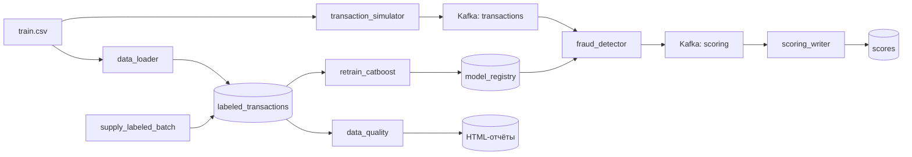

# Переобучение антифрод-модели в Airflow

Это продолжение моего проекта со скорингом транзакций из Kafka. В этой работе я
добавила Apache Airflow: теперь данные для обучения постепенно пополняются, модель
переобучается по расписанию, а новая версия публикуется в общий каталог. Сервис
скоринга замечает новый файл сам, поэтому перезапускать контейнер после обучения
не нужно.

За основу я брала код с занятия 7, но переделала структуру проекта, подготовку
признаков, хранение результатов, проверку качества модели и Data Quality проверки.
Модель простая — CatBoost на CPU, потому что в этой работе важнее сам пайплайн, а
не качество предсказаний.

Предыдущее домашнее задание Kafka → ClickHouse тоже сохранено и запускается
отдельно. Его инструкция находится в [README_hw2.md](README_hw2.md), а Compose —
в `docker-compose.hw2.yml`.

## Что здесь запускается

- `transaction_simulator` отправляет транзакции в Kafka;
- `fraud_detector` читает их, считает `score` и `fraud_flag`;
- `scoring_writer` сохраняет результат и версию модели в PostgreSQL;
- `data_loader` один раз загружает начальную размеченную выборку;
- Airflow запускает три DAG по расписанию;
- Kafka UI нужен, чтобы посмотреть входные и выходные сообщения.

Все сервисы находятся в одной docker-сети. Каталог с моделями одновременно
смонтирован в Airflow и в сервис скоринга.



## Как запустить проект

Нужны Docker Desktop, Docker Compose v2 и примерно 6 ГБ свободной оперативной
памяти. Первый запуск может идти довольно долго, потому что Docker скачивает и
собирает образы Airflow и CatBoost.

```bash
git clone https://github.com/ksnechaeva/ml-syst-proj.git
cd ml-syst-proj
cp .env.example .env
docker compose up --build -d
docker compose ps
```

Я положила в репозиторий небольшой синтетический `data/train.csv`, поэтому для
проверки ничего дополнительно скачивать не нужно. Если хочется использовать другой
CSV, его путь можно задать в `TRAIN_DATA_CSV` в файле `.env`.

После запуска можно открыть:

| Что | Адрес и доступ |
|---|---|
| Airflow | http://localhost:8081, логин `admin`, пароль `admin` |
| Kafka UI | http://localhost:8082 |
| PostgreSQL | `localhost:5433`, пользователь `fraud_user`, пароль `fraud_pass`, БД `fraud_db` |

Проверить, что Airflow увидел DAG-и и в них нет ошибок импорта:

```bash
docker compose exec airflow airflow dags list-import-errors
docker compose exec airflow airflow dags list
```

Должны появиться три DAG: `supply_labeled_batch`, `retrain_catboost` и
`data_quality`.

## Как устроены DAG-и

Все DAG запускаются раз в 5 минут. У них выключен `catchup`, поэтому после простоя
Airflow не пытается выполнить все пропущенные запуски. Их также можно запустить
вручную кнопкой Trigger в UI. В самих файлах из папки `dags/` я оставила только
сборку графа, а код задач вынесла в отдельные модули в `pipeline/`.

### 1. `supply_labeled_batch`

Цепочка задач:

```text
sample_next_month -> append_labeled_batch -> prune_old_months
```

DAG берёт выборку уже размеченных строк, переносит `transaction_time` на следующий
месяц и добавляет батч в витрину. После этого удаляются строки, которые старше
заданной глубины истории.

В моей конфигурации:

- максимальный размер батча — 100 000 строк (`SUPPLY_SAMPLE_SIZE`);
- глубина хранения истории — 3 года (`HISTORY_YEARS`).

Повторный запуск не создаёт копии одного месяца: данные целевого месяца заменяются
атомарно.

### 2. `retrain_catboost`

Цепочка задач:

```text
extract_month_batch
    -> slide_training_window
    -> time_train_test_split
    -> preprocess_dataset
    -> fit_catboost
    -> evaluate_candidate
    -> publish_model
```

Окно обучения состоит из трёх календарных месяцев. Два более ранних месяца идут
в train, самый свежий — в test. Случайный `train_test_split` здесь не используется.
Когда приходит новый месяц, самый старый месяц удаляется из окна.

Мой препроцессинг добавляет следующие признаки:

- расстояние между покупателем и магазином по формуле Haversine;
- `log1p` от суммы;
- признак круглой суммы;
- признак далёкой покупки;
- месяц, день, час и день недели;
- признаки ночной операции, выходного дня и крупной суммы.

Категориальные признаки обрабатывает CatBoost.

После обучения считаются ROC-AUC и F1 на самом свежем месяце. Новая модель
сравнивается с текущей production-версией. Если хотя бы одна доступная метрика
стала хуже с учётом `MODEL_METRIC_TOLERANCE`, кандидат сохраняется как отклонённый,
но файл `latest.txt` не переключается. То есть плохая модель не попадает в
скоринг. Для первой модели сравнения нет, поэтому она принимается автоматически.

Указатель `training_state.next_batch_month` обновляется только после успешного
сохранения и публикации модели. Поэтому при повторном запуске после ошибки месяц
не пропустится и окно не сдвинется второй раз.

### 3. `data_quality`

Цепочка задач:

```text
extract_profile -> validate_profile -> publish_html_report
```

Я проверяю семь правил:

1. датасет не пустой;
2. `transaction_time` заполнен;
3. `amount` заполнен и неотрицателен;
4. `target` содержит только 0 или 1;
5. широта и долгота находятся в допустимых диапазонах;
6. `merch` и `cat_id` не пустые;
7. в данных есть оба класса.

HTML-отчёт создаётся даже при неуспешной проверке, чтобы было видно конкретные
ошибки. Он хранится отдельно от моделей, в каталоге `/opt/airflow/reports`.

Посмотреть список отчётов и скопировать последний на компьютер:

```bash
docker compose exec airflow ls -la /opt/airflow/reports
docker compose cp airflow:/opt/airflow/reports/latest.html ./dq_report.html
```

## Как проверить работу вручную

В Airflow нужно включить DAG-и переключателем и нажать Trigger. То же самое можно
сделать из терминала:

```bash
docker compose exec airflow airflow dags trigger data_quality
docker compose exec airflow airflow dags trigger supply_labeled_batch
docker compose exec airflow airflow dags trigger retrain_catboost
```

После зелёного запуска `retrain_catboost` проверяю, что появился новый файл модели
и изменилась версия в `latest.txt`:

```bash
docker compose exec airflow sh -c \
  'ls -la /opt/airflow/models && cat /opt/airflow/models/latest.txt'
```

Затем проверяю последние результаты скоринга:

```bash
docker compose exec postgres psql -U fraud_user -d fraud_db -c \
  "SELECT transaction_id, round(score::numeric, 4) AS score, fraud_flag, model_version, created_at FROM scores ORDER BY id DESC LIMIT 20;"
```

У новых строк `model_version` должна совпадать со значением из `latest.txt`. Эту
же версию можно увидеть в сообщениях топика `scoring` через Kafka UI.

Состояние окна и количество строк по месяцам:

```bash
docker compose exec postgres psql -U fraud_user -d fraud_db -c \
  "SELECT * FROM training_state; SELECT date_trunc('month', transaction_time), count(*) FROM labeled_transactions GROUP BY 1 ORDER BY 1;"
```

Если что-то не запускается, сначала смотрю логи:

```bash
docker compose logs -f airflow fraud_detector scoring_writer
```

Обычная остановка сохраняет данные:

```bash
docker compose down
```

Полный сброс вместе с томами и накопленными данными:

```bash
docker compose down -v
```

Команду с `-v` я использую только тогда, когда действительно хочу начать проверку
с чистого состояния.
